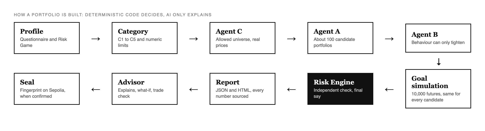

<div align="center">


# EgoQuant

**A wealth-advisory agent you can understand, question and audit.**<br>
Engine and API · 2026 Shenzhen FinTechathon · WeBank International Track · Topic B

<a href="https://www.egoquant.app"></a>
<a href="https://web-production-59960.up.railway.app/docs"></a>
<a href="submission/1_Technical_Documentation/00_EgoQuant_Technical_Documentation.pdf"></a>
<a href="https://github.com/EgoQuantAI/egoquant-frontend"></a>


</div>

---

You answer a proper risk questionnaire, play a short game about risk and say what you'd like to hold. You get a portfolio that fits you, with every number explained and checked by a second, independent piece of code. An AI assistant explains the result and can try "what if" questions, but **it never decides anything**. If you confirm a plan, a fingerprint of it goes on a public test blockchain, so you can prove later that nobody changed it.

> [!NOTE]
> This repository is a snapshot of the version we submitted on 20 October 2026 (tag `submission-20oct`), in one commit. Our day-to-day history stays in a private repository.

<p align="center">
  
</p>

## Highlights

| | |
|---|---|
| **Suitability first** | Your category is the *lower* of what your finances allow and how you feel about risk; the Risk Game counts one third of the attitude part |
| **An independent Risk Engine** | Recomputes every limit from the weights alone and has the final say; only an approved portfolio is shown |
| **Behaviour can only tighten** | A real trading history (IBKR) and a crash test can lower your limits, never raise them |
| **The advisor explains, never decides** | Whitelisted tools, every number checked against the engine, personal data replaced by placeholders, a compliance filter |
| **Tamper-evident advice** | A salted fingerprint of the confirmed plan on Sepolia; anyone can check a report on the **Verify** page |
| **One person never sees another's data** | Row-Level Security in the database, a second filter in the backend, no all-powerful key anywhere |

## How a portfolio is built

<p align="center"></p>

## Try it in two minutes

Open **[www.egoquant.app](https://www.egoquant.app)**, choose **Verify a report** in the sidebar, press **Use the demo report**, then **Try a tampered copy**. The first checks a real sealed report against the Sepolia test chain; the second shows what happens when one number was changed. The full path is in the [user guide](docs/judges/05_USER_GUIDE_AND_DEMO.md).

## Run it on your machine

You need Python 3.11 or newer (we run 3.14). No API key is needed: the repository carries a saved snapshot of real market prices.

```bash
git clone https://github.com/EgoQuantAI/egoquant-backend.git
cd egoquant-backend
python -m venv .venv
source .venv/bin/activate              # Windows: .venv\Scripts\activate
pip install -e ".[dev]"
export EGOQUANT_PRICE_MODE=snapshot    # Windows: set EGOQUANT_PRICE_MODE=snapshot
uvicorn main:app --reload
```

Open http://127.0.0.1:8000/docs: `GET /questionnaire` reads the questions, `POST /profile` scores answers, `POST /portfolio` builds a portfolio. For the website on top, see the [frontend README](https://github.com/EgoQuantAI/egoquant-frontend).

<details>
<summary><b>Optional keys</b> (everything else works without them)</summary>

| Feature | What you need | Without it |
|---|---|---|
| Advisor chat | `OPENAI_API_KEY` | The chat says it is unavailable; reports, limits and trade checks still work |
| Live prices | `TIINGO_API_KEY` and `EGOQUANT_PRICE_MODE=live` | The saved snapshot of real prices (to 16 October 2026) is used and labelled |
| Accounts and saved reports | a Supabase project (`SUPABASE_URL`, `SUPABASE_ANON_KEY`) | Everything works as a visitor; nothing is saved |
| Sealing on the test chain | `EGOQ_SEAL_ENABLED=1`, `EGOQ_SEAL_PRIVATE_KEY`, `EGOQ_SEAL_RPC_URLS` | Plans can be confirmed; no fingerprint is published |

Every setting, with a sentence each: [`docs/DEPLOY_ENV.md`](docs/DEPLOY_ENV.md).
</details>

## Test cases

```bash
pytest -q -m "not live"
```

**3,554 tests**, with no network and no calls to the language model; 7 to 35 minutes depending on the machine. `-m "not live"` leaves out the 21 tests that need live market data. On Windows the numerical libraries sometimes crash a long test process; then run one folder at a time with `python eval/run_tests_per_file.py . results.txt --dir tests/system` ([why](docs/judges/04_TESTING_AND_EVIDENCE.md)).

<details>
<summary><b>Tests by area</b></summary>

| Folder under `tests/` | Tests | What it covers |
|---|---:|---|
| `agent_b` | 680 | Behaviour from a trade history, the IBKR file parser including hostile files, the crash test |
| `anchoring` | 464 | The on-chain seal: record, fingerprint, sealed report, every committed proof, tampering attempts |
| `briefing` | 414 | News items, tone labels, the advice filter, background jobs |
| top level | 407 | Routes, request-size limits, chat, price-feed fallback drills, plain wording, no echo of user input |
| `system` | 360 | The whole chain: pipeline, Risk Engine, report, goal simulation, what-if, trade check, Risk Game blend |
| `agent_a` | 287 | The optimiser, the backtest and the optional second method |
| `agent_c` | 274 | Universe choice, price sources, snapshots, caches, fallbacks |
| `accounts` | 265 | User A can never reach user B's data, saved reports, hostile inputs, the chat's trade tool |
| `risk_profile` | 134 | Questionnaire, scoring, the C1 to C5 table |
| `advisor` | 105 | Advice guard, trade explanations, behaviour when the AI is down |
| `regime` | 90 | The market-phase sampler and its fall-back |
| `preferences` | 60 | The investment-preference form |

Counts from `pytest --collect-only` on the final candidate, before the last changes brought the total to 3,554; the last complete runs are in [`04_TESTING_AND_EVIDENCE.md`](docs/judges/04_TESTING_AND_EVIDENCE.md).
</details>

Beyond the unit tests:

- `python eval/deploy_check.py https://your-backend` checks a deployed copy, read-only. The live copy passes **71 of 71**.
- `supabase/tests/rls_isolation.sql` and `rls_onchain.sql` prove Row-Level Security on a real Supabase project; both pass on ours.
- `eval/chat_redteam.py` and `eval/trade_explain_redteam.py` are live red-teams of the advisor; results are kept in `eval/results/`.
- `python -m egoquant.anchoring verify <file>` checks a seal against the chain without our website.

## Deploy it

See **[DEPLOYMENT.md](DEPLOYMENT.md)**. Short version: the backend is one Python process (we use Railway), the website is a Next.js app (we use Vercel), accounts are a Supabase project.

## What is where

<details>
<summary><b>Repository map</b></summary>

| Path | What it is |
|---|---|
| `main.py`, `egoquant_routes.py`, `chat.py` | The FastAPI app, its routes and the advisor chat |
| `egoquant/risk_profile/` | Questionnaire, scoring, the C1 to C5 category and its limits |
| `egoquant/agents/market_intel/` | Agent C: product catalogue (R1 to R5), allowed universe, prices |
| `egoquant/agents/quant/`, `egoquant/regime/` | Agent A: candidate portfolios and the goal simulation |
| `egoquant/agents/behavioral/` | Agent B: behaviour from a real trade history; can only tighten limits |
| `egoquant/risk_engine.py` | The independent Risk Engine that has the final say |
| `egoquant/advisor/`, `egoquant/briefing/` | Advisor safeguards; the read-only news briefing |
| `egoquant/accounts/`, `supabase/` | Accounts (Supabase, Row-Level Security) and the database migrations |
| `egoquant/anchoring/` | The on-chain seal and its verifier |
| `tests/`, `eval/` | Automatic tests; evaluation scripts, red-teams and the deploy check |
| `docs/judges/` | The documents for the judges ([start here](docs/judges/README.md)) |
| `submission/` | The submission package: PDFs, slides, evidence |
</details>

## Documentation

| Document | |
|---|---|
| [Technical documentation (one PDF)](submission/1_Technical_Documentation/00_EgoQuant_Technical_Documentation.pdf) | Architecture, algorithms, security design and every supporting document |
| [Security and compliance report](docs/judges/02_SECURITY_COMPLIANCE_REPORT.md) | Suitability, access control, privacy, AI governance, residual risks |
| [Methods and models](docs/judges/03_METHODS_AND_MODELS.md) · [part B](docs/judges/03b_METHODS_QUANT_RISK_ADVISOR.md) | How every number is computed |
| [Testing and evidence](docs/judges/04_TESTING_AND_EVIDENCE.md) | Test counts, red-teams, probes, how to re-run |
| [The on-chain seal](docs/judges/09_ON_CHAIN_SEAL.md) | What is sealed, what it proves, how to check it |

> [!IMPORTANT]
> EgoQuant places no orders and moves no money. The category limits are our own placeholders, not a bank's policy. Every chance it shows is a simulation on past prices, not a forecast. Known weaknesses: [limitations and roadmap](docs/judges/06_LIMITATIONS_AND_ROADMAP.md) and [`docs/SECURITY.md`](docs/SECURITY.md).

---

<sub>The long technical README of the development repository: [README_DETAILED.md](README_DETAILED.md).</sub>
